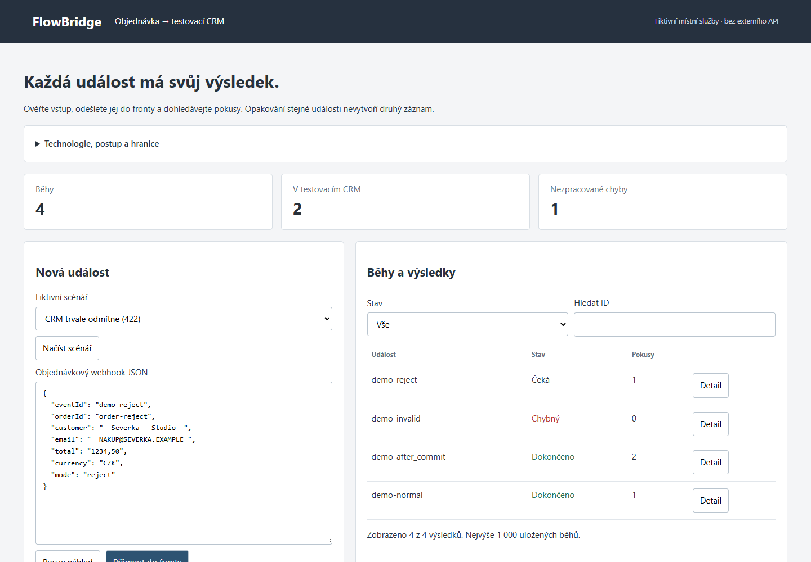

# FlowBridge

## Rychlá ukázka pro zájemce a HR

Přenese fiktivní objednávku do testovacího CRM, bezpečně řeší opakování a ukáže historii pokusů.

**[Prohlédnout veřejnou ukázku](https://omegacatt.github.io/datadesk/portfolio/#flowbridge)** - bez instalace a přihlášení.

Veřejný odkaz ukazuje uložený snímek výsledků. Plnou aplikaci si spustíte na počítači podle návodu níže.

## Spuštění krok za krokem (Windows)

1. Nainstalujte **Python 3.13 nebo novější** z oficiálního webu [Python](https://www.python.org/downloads/windows/). Potom zavřete a znovu otevřete Terminál, pokud už běžel.
2. Nahoře na této stránce GitHubu klikněte na zelené **Code** a potom **Download ZIP**.
3. Stažený ZIP rozbalte: pravým tlačítkem → **Extrahovat vše**. Otevřete rozbalenou složku `flowbridge-main`. Pokud je uvnitř ještě jedna stejně pojmenovaná složka, otevřete i ji; musíte vidět soubor `server.py`.
4. Otevřete v této složce **Terminál**. Jednoduchá cesta: v horním adresním řádku Průzkumníka napište `powershell` a stiskněte **Enter**. Otevře se příkazové okno přímo v této složce.

Napište tento příkaz a stiskněte **Enter**:

```powershell
py -3 server.py
```

Terminál **nechte otevřený**. To, že příkaz dál běží a nevrací se nový řádek pro psaní, je v pořádku. V prohlížeči otevřete:

**[http://127.0.0.1:4196](http://127.0.0.1:4196)**

Adresa vede jen do vašeho počítače. Aplikace používá připravená **fiktivní data**. U připraveného scénáře nejdřív otevřete náhled a pak odešlete událost. Po dokončení ji odešlete znovu: počet záznamů v CRM se nemá zvýšit. Další scénář ukáže ztracené potvrzení a opakování. CRM je druhá místní ukázková služba, nikoli připojená firemní aplikace.

**Vypnutí:** vraťte se do Terminálu a stiskněte **Ctrl+C**. Pro příští spuštění znovu otevřete Terminál ve stejné složce a napište už jen spouštěcí příkaz výše.

Pokud se objeví chyba, otevřete [řešení běžných potíží a další možnosti](docs/SPUSTENI.md). Vývojové testy ani znalost programování nejsou podmínkou pro prohlédnutí veřejné ukázky.

---

## Orientace v aplikaci (11. 11. 2026)

Při první návštěvě se otevře stručný návod. Po zavření si aplikace v tomto prohlížeči zapamatuje potvrzení; změna nemá vliv na obchodní data. V hlavičce lze kdykoli otevřít **Jak aplikaci používat** a **Technické informace**. Oba obsahy odkazují na úplný README zde na GitHubu. Pokud úložiště prohlížeče není dostupné, návod lze zavřít a aplikace dál funguje.

Doplněná úvodní nápověda a stručné technické vysvětlení v hlavičce. Integrační engine této UI etapy se nemění.


**Od fiktivní objednávky k potvrzenému zápisu v CRM.** Místní integrační fronta ukazuje validaci, normalizaci, HTTP přenos, opakování po výpadku, idempotenci a řešení chyb.



## Vyzkoušení

Vyžaduje Python 3.13+, bez běhových balíčků nebo API klíčů.

```powershell
python server.py
```

Otevřete [127.0.0.1:4196](http://127.0.0.1:4196). Spustí se dvě skutečné HTTP služby na loopbacku: aplikace 4196 a oddělené testovací CRM 4197. Obě databáze vzniknou v ignorované složce data/. Porty a adresář lze určit --port, --crm-port a --data. Nepoužívejte skutečné zákaznické údaje.

1. Načtěte připravený scénář a zvolte „Pouze náhled“. Uvidíte normalizované jméno/e-mail a přesnou částku v haléřích. Fronta ani CRM se nezmění.
2. Přijměte událost do fronty. Worker ji atomicky převezme a odešle do CRM skutečným HTTP požadavkem. Tabulka se obnovuje každou sekundu.
3. Stejnou událost odešlete znovu: vrátí se existující běh. Změněný obsah pod stejným ID je konflikt, nepřepisuje původní událost.
4. Vyzkoušejte CRM s chybou 503 nebo 429: objeví se odložený další pokus. Scénář „zápis proběhne, potvrzení selže“ vrátí po cílovém zápisu 503. Opakovaný HTTP pokus se stejným klíčem vrátí již existující záznam, nikoli druhou objednávku.
5. Neplatný e-mail nebo trvalé 422 skončí ve frontě chyb. Platný, ale odmítnutý běh lze ručně znovu zařadit bez změny identity a s úplnou historií. Chybný vstup se neopakuje; oprava je nová událost s novým ID.
6. Otevřete detail a stáhněte zdroj, transformaci a časovou osu jako JSON. Snímek exportu je záznam okamžiku, nikoli podepsaný audit.

## Co je použito a proč

- **Python standardní knihovna, SQLite WAL a parametrizované SQL.** Dvě databáze oddělují zdrojovou frontu a cílové CRM. Peníze se z desetinného textu převádějí přes Decimal, nikoli float.
- **ID a SHA-256 původního strukturovaného obsahu.** Atomická transakce rozhodne o přijetí, duplicitě nebo konfliktu. Normalizace nemění uchovaný originál. Cíl znovu kontroluje idempotency klíč i otisk normalizovaného payloadu; orderId je navíc jedinečný.
- **Trvalé stavy pending/processing/retry/succeeded/dead.** Převzetí má desetisekundový lease. Po přerušení se po vypršení nároku obnoví stejná identita. Pozdní výsledek staršího pokusu nemůže přepsat novější nárok.
- **Nejvýše tři pokusy v cyklu.** Síťové chyby, 5xx a 429 mají odklad 2 a 4 sekundy; Retry-After se omezí na 2–60 sekund. Ostatní HTTP chyby se automaticky neopakují. Replay má nejvýše dva další ruční cykly a zachová předchozí pokusy.
- **HTML/CSS/JS.** Jednoduchý přehled, filtry, zdroj, transformace, časová osa a export. Texty se nevkládají jako HTML. Změna vstupu zneplatní opožděný náhled.

Doručování má opakované pokusy; nevydáváme je za univerzální „exactly once“ transport. Ochrana před duplicitním cílovým zápisem vyžaduje spolupráci CRM a stejný klíč. Ukázkové CRM ji implementuje. Reálný konektor ji musí doložit zvlášť.

## Vstupní kontrakt

JSON do 16 000 bajtů, přesně sedm textových polí (do 200 znaků); ID 1–80 znaků A–Z, a–z, 0–9, pomlčka, podtržítko. Částka je kladný desetinný text do osmi číslic a dvou desetinných míst; pouze CZK.

```json
{"eventId":"demo-001","orderId":"order-001","customer":"Severka Studio","email":"nakup@severka.example","total":"1234,50","currency":"CZK","mode":"normal"}
```

mode ovládá výhradně testovací závadu: normal, transient, rate_limit, reject, outage, after_commit. Nemění externí služby. URL cíle není vstupní pole a používá pouze vlastní loopback CRM. POST /api/preview neprovádí zápis; POST /api/events přijímá událost, GET /api/jobs a /api/job?id= ukazují stav, POST /api/replay obnoví oprávněný chybný běh. Každý server kontroluje Host/Origin; bez CORS a bez autentizace. API není určeno veřejnému provozu.

[Ověřené CI kódu 98cb68a](https://github.com/OmegaCatt/flowbridge/actions/runs/42729883848) · [Zaznamenaný postup](https://omegacatt.github.io/datadesk/portfolio/) (statický snímek)

## Ověření

```powershell
python -m unittest discover -s test -v
pnpm install --frozen-lockfile
pnpm exec playwright install chromium
pnpm check
pnpm qa
```

13 Python testů: skutečné HTTP, přesné peníze, žádný zápis v náhledu, dočasné/trvalé chyby, limit pokusů, ztracené potvrzení po zápisu, atomický souběh, obnovení lease, restart obou služeb a konflikty na obou stranách. Browser QA používá izolované dočasné databáze a ověřuje plný pracovní postup, export, filtr, replay a mobil 390 px bez přetečení/JS chyb. Volitelné FLOWBRIDGE_PYTHON a PLAYWRIGHT_EXECUTABLE_PATH. GitHub Actions opakuje stejný postup bez externího API. Podrobnosti: [QA](docs/QA.md).

## Zavedení do firmy a hranice

Začít schválenou testovací smlouvou dat a skutečným sandboxem CRM. Přidat podpisy webhooků a ověření odesílatele, účty/role a HTTPS, správu tajemství, robustní provozní server/worker, trvalý monitoring, zálohy a retenční pravidla. Pro konkrétní cíl ověřit idempotenci, klasifikaci chyb, limity a retry kontrakt. Teprve potom připojit reálná data. n8n/Make konektor je možný další krok; není zde implementovaný.

Limit je 1 000 běhů a nejvýše 100 zobrazených položek po filtrování. Data se lokálně uchovávají i po restartu a nemají automatickou retenci. Ukázka nemá přihlášení, firemní oprávnění, produkční SLA ani reálný CRM konektor. AI zde není potřebná: transport, validace a opakování mají mít předvídatelné chování.

## English

First-time visitors see a keyboard-accessible guide; persistent header buttons reopen usage and technical information with a link to this README. Acknowledgement is browser-local and does not store business records. First-visit guidance and header technical help were added. This UI stage does not change the integration engine.


A fictional order webhook → validation/normalization → durable SQLite queue → actual HTTP request to a separate local mock CRM. Python 3.13 standard library, two loopback services/databases, plain HTML/CSS/JS. No credentials, AI or external company integration.

Atomic event/hash conflict checks and target idempotency prevent duplicate records under repeated delivery, including a committed target write followed by a failed acknowledgement. Transient/network errors retry with bounded backoff; permanent failures enter the dead-letter queue. Three attempts per cycle, two manual replay cycles, persisted attempts/timeline and lease recovery. Dry run writes nothing. Input/source/transform, filters and JSON evidence are visible in the UI.

Run python server.py and open 127.0.0.1:4196. 13 Python tests plus isolated desktop/mobile browser QA cover actual HTTP, concurrency, restarts and failure modes. This is a bounded fictional demo, not a production queue or real CRM connector. Company adoption needs authenticated/signed webhooks, secrets, access controls, production workers, monitoring, retention and a tested target-specific contract.
